<div align="center">


# Gym Guru

**An AI personal trainer that fits in five minutes a day.**

Gym Guru watches each rep through your phone's camera, coaches your form in real time,<br/>
and turns training into a game: 20 levels, stars, XP, streaks and a global leaderboard.

[](https://github.com/ankitpokhrel08/gym-guru/actions/workflows/ci.yml)


[Overview](#overview) · [Screenshots](#screenshots) · [Architecture](#architecture) · [Getting started](#getting-started) · [Roadmap](#roadmap)

</div>

<p align="center">
  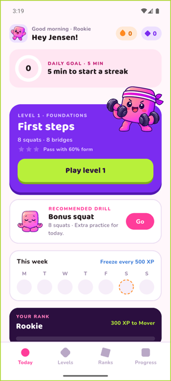
  &nbsp;&nbsp;
  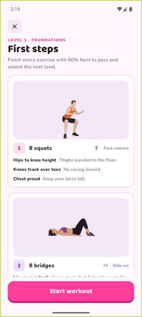
  &nbsp;&nbsp;
  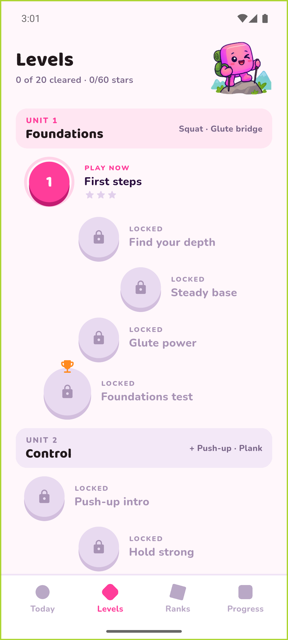
</p>

## Overview

Most people quit training because sessions run long and nobody checks their form. Gym Guru keeps workouts short and gives feedback on every rep:

1. **Pick a level.** Each one is a short workout of 2–5 exercises with an animated demo of each move.
2. **Train in front of the camera.** On-device pose tracking counts reps, times holds and flags form mistakes as they happen.
3. **Level up.** Earn 1–3 stars, XP and badges, keep your daily streak, and climb the weekly leaderboard.

### Features

| | |
| --- | --- |
| **Google sign-in** | Firebase Auth. Progress syncs across devices and works offline. |
| **Short setup** | Name and public nickname, one goal, daily minutes, experience and pain limitations. All editable later in Profile. |
| **6 tracked exercises** | Squat, push-up, plank, reverse lunge, glute bridge and jumping jacks, each with its own form checks. |
| **20 levels** | 4 units of 5, each ending in a boss level. New exercises arrive unit by unit, and experience sets where you start. |
| **Adapts to you** | Knee pain swaps lunges and jumping for bridges and eases squat depth; lower-back pain shortens planks. |
| **Recommendations** | Today offers your next level plus a drill aimed at your weakest exercise and most common mistake. |
| **Gamification** | Stars, XP, 6 ranks (Rookie → Legend), 9 badges, a daily-goal ring, streaks with earned freezes, and rewards for unlocks and rank-ups. |
| **Leaderboard** | Weekly and all-time, top 50 plus your rank, shown by nickname only. |

> [!NOTE]
> Rep counting runs entirely on the device with Google ML Kit. Camera frames are never stored or uploaded. If the camera is unavailable or can't see you, the app offers a clearly labelled **demo set** that earns nothing.

## Screenshots

**Sign-in and setup**

<p>
  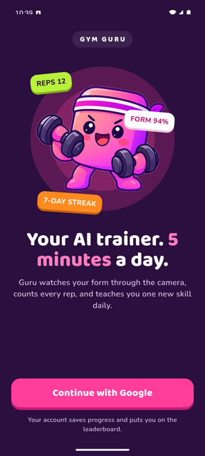
  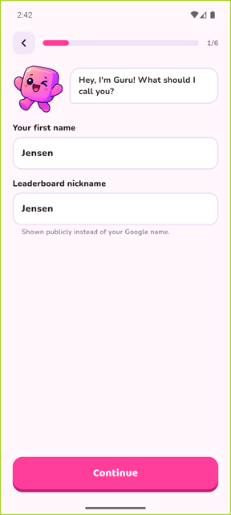
  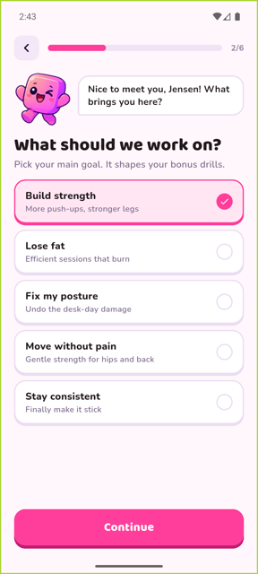
  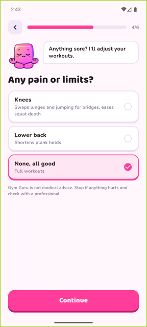
  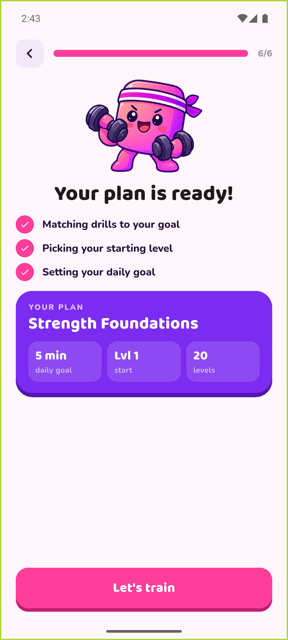
</p>

**Training**

<p>
  
  
  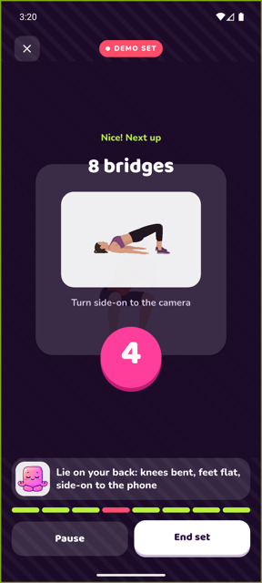
  
</p>

**Progress and profile**

<p>
  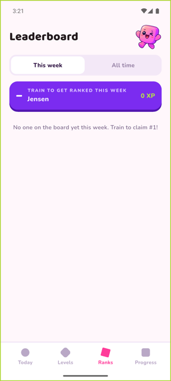
  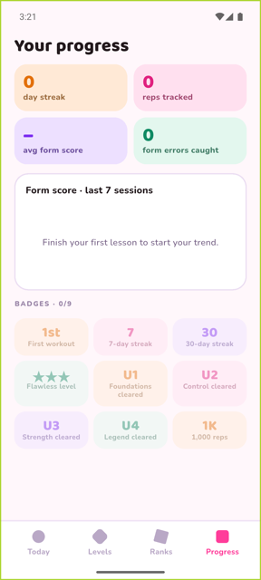
  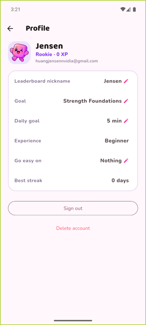
</p>

## Architecture

### App flow

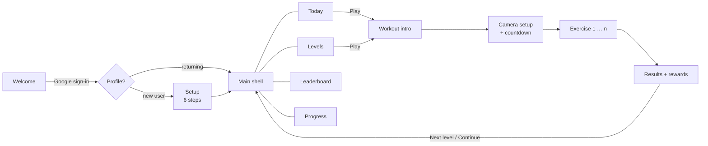

### Code layout

```
lib/
├── main.dart                   Firebase init, fonts, portrait lock
├── app_root.dart               Sign-in → setup → main app routing
├── firebase_options.dart       Generated by FlutterFire (Android)
├── theme/app_theme.dart        Colour tokens, Baloo 2 / Nunito text styles
├── widgets/
│   ├── common.dart             Buttons, cards, headers, speech bubbles
│   ├── decor.dart              Painters and shapes (stripes, dashed outlines, week strip)
│   └── exercise_demo.dart      Looping Lottie demo for each exercise
├── game/
│   ├── exercises.dart          The 6 exercises, their cues and form issues
│   ├── levels.dart             The 20 levels, limitation adaptations, start levels
│   └── progression.dart        Stars, XP, ranks, badges, drill recommendations
├── data/
│   ├── models.dart             Profile, SessionResult, BlockResult (JSON)
│   ├── auth.dart               Google sign-in through Firebase Auth
│   └── repository.dart         Firestore: profile, sessions, leaderboard
├── tracking/
│   ├── tracker.dart            Workout lifecycle: setup → countdown → blocks → done
│   ├── camera_tracker.dart     Front camera + ML Kit pose detection
│   ├── analyzers.dart          Per-exercise rep counting and form checks (pure Dart)
│   ├── simulated_tracker.dart  Scripted demo set
│   └── pose.dart               Joints and skeleton edges
├── onboarding/                 Setup flow and its screens
└── app/
    ├── main_shell.dart         Tabs and workout routing
    ├── app_controller.dart     Streaks, XP, stars, unlocks, freezes, rewards
    └── screens/                Today, levels, leaderboard, progress, profile, intro, camera, results, share
```

### Design decisions

- **One source of truth:** `AppController` derives streak, XP, stars, unlocks, badges and the week strip from stored sessions instead of keeping separate counters.
- **Pose analysis:** each exercise has a pure-Dart analyzer working on 2D landmarks:
  - **Squats:** measured by how far the hips drop toward knee height, calibrated to the standing pose, which works facing the camera or side-on.
  - **Push-ups, lunges and bridges:** measured from joint angles.
  - **Plank:** graded in 5-second segments.
  - **Jumping jacks:** checked for full arm and leg range.
  
  The analyzers were validated on real Kaggle exercise videos (see `tool/video_eval`).
- **Setup gate:** counting starts only when the body is in frame, landmarks are confident and the user is still. Side-on exercises need just one full side visible.
- **Daily goal and streaks:** a day counts when active training time reaches the daily goal. Streak freezes (one per 500 XP, hold up to 2) cover a single missed day automatically.
- **Leaderboard integrity:** on Firebase's free plan the app writes its own totals, so Firestore security rules check every write. Only you can write your row, XP never decreases, and one write can add at most one workout's XP.
- **Offline-first:** Firestore's on-device cache keeps training working offline. Startup waits at most 4 seconds for the server before using cached data.
- **Accessibility:** custom controls expose semantics, coaching cues are live regions, and animations show a still frame when the system's reduce-motion setting is on.

## Getting started

### Requirements

| Tool | Version |
| --- | --- |
| Flutter | 3.47 (stable) |
| JDK | 17 or newer |
| Android SDK | API 36 |

### Run

```bash
git clone https://github.com/ankitpokhrel08/gym-guru.git
cd gym-guru
flutter pub get
flutter run
```

The app is configured for the existing Firebase project. To use your own, run `flutterfire configure --platforms=android`, add your signing key's SHA-1 to the Android app in Firebase, enable Google sign-in, and deploy the rules and indexes with `firebase deploy --only firestore`.

### Tracking tips

Use a physical phone; emulator cameras rarely give a usable feed. Prop the phone at about hip height, 2–3 m away, so your whole body is in frame, and train in good light. Each workout intro shows whether to face the camera or turn side-on.

### Build

```bash
flutter build apk --release                   # universal APK
flutter build apk --release --split-per-abi   # smaller per-device APKs
```

The APK is written to `build/app/outputs/flutter-apk/`. CI also builds one on every push to `main`; download it from the run's **Artifacts** section.

> [!IMPORTANT]
> Release builds currently use the debug signing key. That's fine for sideloading, but Google Play needs a real upload key, and that key's SHA-1 must also be added to Firebase for Google sign-in to work.

## Testing

```bash
dart format --output=none --set-exit-if-changed lib test
flutter analyze
flutter test
```

| Suite | Covers |
| --- | --- |
| `analyzers_test.dart` | Rep counting and form checks for all 6 exercises, plus setup checks |
| `app_controller_test.dart` | Stars, XP, ranks, levels, drills, daily-goal streaks, freezes, demo sets not saved, profile edits |
| `app_flow_test.dart` | Sign-in, setup, a full level, leaderboard ranking, nickname edit, account deletion |
| `exercise_demo_test.dart` | Every animation loads, swaps cleanly and respects reduced motion |
| `firestore_config_test.dart` | Every leaderboard query has a deployed index; rules cover the app's collections |

To re-run the real-video evaluation, extract poses with MediaPipe and run `POSES=<dir> flutter test tool/video_eval`.

## Roadmap

- [x] On-device pose tracking for 6 exercises
- [x] Google sign-in, cloud sync and a global leaderboard
- [x] 20 levels with stars, XP, ranks, badges and streaks
- [ ] Voice coaching
- [ ] Working share targets (Story, Message, Save)
- [ ] Server-validated leaderboard scores (Cloud Functions)
- [ ] iOS build
- [ ] Custom app icon and launch screen

## Credits

Exercise animations from [LottieFiles](https://lottiefiles.com) under the Lottie Simple License; see [assets/exercises/CREDITS.md](assets/exercises/CREDITS.md).

## Author

Built by **Ankit Pokhrel** ([@ankitpokhrel08](https://github.com/ankitpokhrel08)).

## License

No license has been chosen yet, so all rights are reserved until one is added.
