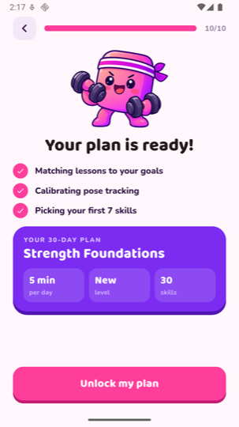
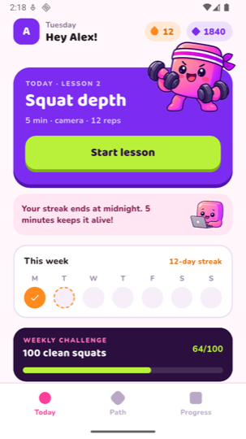
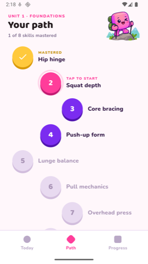
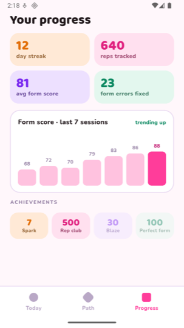

<div align="center">

# Gym Guru

**Your AI trainer. 5 minutes a day.**

Gym Guru watches your form through the camera, counts every rep, and teaches you one new movement skill a day.

[](https://flutter.dev)
[](https://dart.dev)
[](#)
[](#testing)

</div>

---

## Screenshots

<table>
  <tr>
    <td align="center"><br/><sub>Welcome</sub></td>
    <td align="center"><br/><sub>Goal selection</sub></td>
    <td align="center"><br/><sub>Live form check</sub></td>
    <td align="center"><br/><sub>Micro-lesson quiz</sub></td>
  </tr>
  <tr>
    <td align="center"><br/><sub>Personal plan</sub></td>
    <td align="center"><br/><sub>Free trial</sub></td>
    <td align="center"><br/><sub>Today</sub></td>
    <td align="center"><br/><sub>Skill path</sub></td>
  </tr>
  <tr>
    <td align="center"><br/><sub>Progress</sub></td>
    <td align="center"><br/><sub>Live tracked set</sub></td>
    <td align="center"><br/><sub>Lesson results</sub></td>
    <td align="center"><br/><sub>Share card</sub></td>
  </tr>
</table>

## Features

- **Guided onboarding.** Ten short steps cover goals, daily time, experience level and a sample lesson, then build a plan named after the user's first goal.
- **Daily micro-lessons.** Each lesson has a short demo, three cues to watch for, and a tracked set of 12 reps.
- **Live form feedback.** The rep counter, form score and on-screen cues update during each set. Knee and depth errors are flagged on the rep where they happen.
- **Streaks and progress.** Streak, XP, weekly challenge, a form-score history and achievements, all on the Progress tab.
- **Skill path.** A zig-zag path of movement skills, with mastered, current and locked states.
- **Shareable results.** Streak, form score and skill cards, ready to post.

> **Status:** the UI, navigation and lesson flow are complete. The camera feed and pose tracking are **simulated** for now. Real pose estimation, persistence and payments are on the roadmap below.

## Tech stack

| Area | Choice |
| --- | --- |
| Framework | Flutter (Material 3), Dart 3 |
| State | `ChangeNotifier` controllers with `ListenableBuilder` |
| Typography | Baloo 2 (display) and Nunito (body), bundled for offline use |
| Graphics | `CustomPainter` for the pose skeleton, camera texture and dashed outlines |
| Testing | `flutter_test` widget and flow tests |

## Project structure

```
lib/
├── main.dart                  App entry point, font licences, orientation
├── theme/
│   └── app_theme.dart         Colours, text styles, shared shadows
├── widgets/
│   ├── common.dart            Buttons, headers, cards, speech bubbles
│   └── decor.dart             Painters and shapes shared across flows
├── onboarding/
│   ├── onboarding_flow.dart   Page-based onboarding and paywall handoff
│   ├── onboarding_controller.dart
│   └── screens/               One file per onboarding step
└── app/
    ├── main_shell.dart        Today / Path / Progress tabs
    ├── app_controller.dart    Streak, XP, sessions and path state
    ├── screens/               Home, path, stats, lesson, camera, results, share
    └── widgets/rep_dots.dart  Rep-by-rep indicator

assets/
├── mascot/                    Guru mascot illustrations
└── google_fonts/              Bundled fonts and their OFL licences

test/                          Widget and end-to-end flow tests
```

## Getting started

### Prerequisites

- Flutter 3.47 or newer (stable channel) with Dart 3.13 or newer
- Android Studio or Xcode, depending on the target platform

### Run locally

```bash
git clone https://github.com/ankitpokhrel08/gym-guru.git
cd gym-guru
flutter pub get
flutter run
```

### Build a release APK

```bash
flutter build apk --release
# Output: build/app/outputs/flutter-apk/app-release.apk
```

For smaller per-device files, add `--split-per-abi`.

## Testing

```bash
flutter analyze
flutter test
```

The suite covers the paywall CTA (annual starts the trial, monthly continues onboarding) and a full lesson run: start, camera setup, scripted form errors, results, and the streak update on Today.

## Roadmap

- [ ] Real pose estimation (MediaPipe or ML Kit) to replace the simulated skeleton
- [ ] Persist profile, sessions and streaks locally, then sync
- [ ] Sign-in and "I already have an account" flow
- [ ] Real purchases for the annual and monthly plans
- [ ] Working share targets (Story, Message, Save)
- [ ] Lesson video content

## Contributing

Issues and pull requests are welcome. Please run `flutter analyze` and `flutter test` before opening a PR, and keep commit messages short and imperative (for example, `feat: add paywall`).

## Author

**Ankit Pokhrel**: [@ankitpokhrel08](https://github.com/ankitpokhrel08)

## License

No license has been chosen yet. All rights reserved until one is added.
