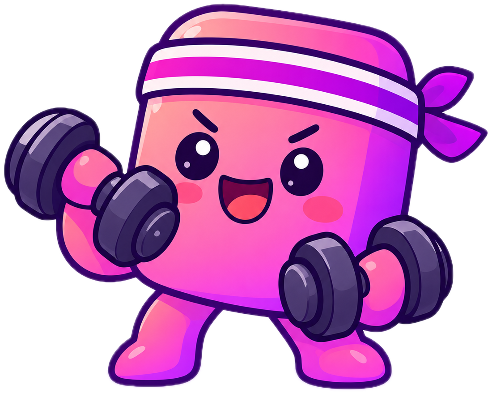
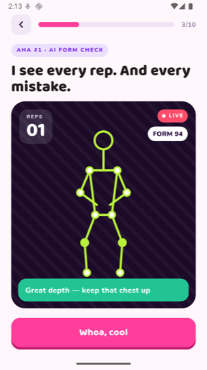
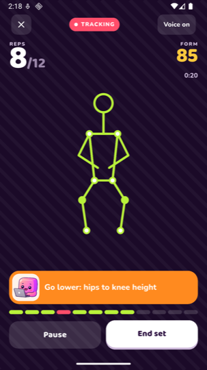
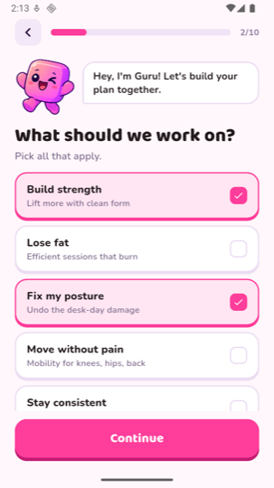
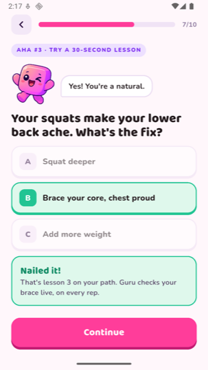
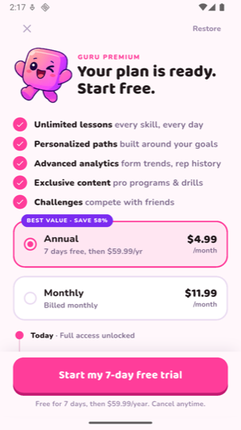
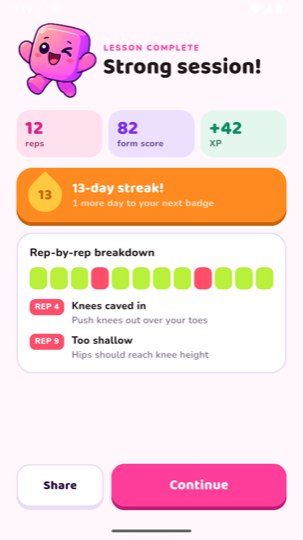
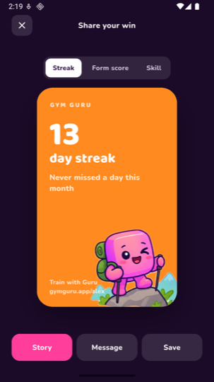
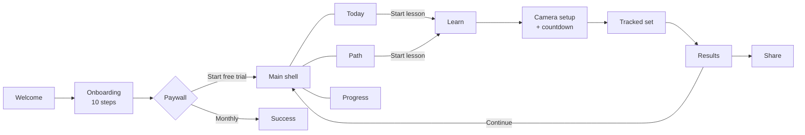

<div align="center">



# Gym Guru

**An AI personal trainer that fits in five minutes a day.**

Gym Guru teaches one movement skill per day, watches each rep through the camera,<br/>
and coaches form in real time, with streaks to keep the habit going.

[](https://github.com/ankitpokhrel08/gym-guru/actions/workflows/ci.yml)


[Overview](#overview) · [Screenshots](#screenshots) · [Architecture](#architecture) · [Getting started](#getting-started) · [Roadmap](#roadmap)

</div>

<p align="center">
  
  &nbsp;&nbsp;
  
  &nbsp;&nbsp;
  
</p>

## Overview

Most people quit training because sessions are long and form feedback is missing. Gym Guru turns training into short daily lessons:

1. **Learn** one skill, such as squat depth, from a short demo and three cues.
2. **Practise** a tracked set of 12 reps in front of the phone camera.
3. **Review** a form score, rep-by-rep errors and XP, then keep the streak alive.

### Features

| | |
| --- | --- |
| **Onboarding** | Ten steps (goals, daily time, level, a sample lesson) that end in a personal 30-day plan and a free-trial paywall. |
| **Daily lesson loop** | Learn → camera setup → countdown → tracked set → results → share. |
| **Form coaching** | Live rep counter, form score and contextual cues. Errors are flagged on the exact rep where they happen. |
| **Skill path** | Units of movement skills with mastered, current and locked states. One new lesson unlocks per day. |
| **Progress** | Streak, XP, weekly challenge, 7-session form trend and achievements. |
| **Sharing** | Streak, form-score and skill cards, sized for stories. |

> [!NOTE]
> This is an **MVP**. Rep counting and form checks run on-device with Google ML Kit pose detection, and progress is saved locally. Tracking currently understands **bodyweight squats** only, so every lesson uses a squat set. Devices without a usable camera can run a scripted demo set instead. Accounts, payments and cloud sync are on the [roadmap](#roadmap).

## Screenshots

**Onboarding**

<p>
  
  
  
  
  
  
</p>

**Core app**

<p>
  
  
  
  
  
  
</p>

## Architecture

### App flow



### Code layout

```
lib/
├── main.dart                     Entry point, bundled-font licences, portrait lock
├── theme/app_theme.dart          Colour tokens, Baloo 2 / Nunito text styles, hard shadows
├── widgets/
│   ├── common.dart               Shared UI: ChunkyButton, FlowPage, SpeechBubble, StatTile …
│   └── decor.dart                Painters and shapes: stripes, dashed outlines, teardrop, week strip
├── onboarding/
│   ├── onboarding_flow.dart      PageView flow, back handling, hand-off to the app
│   ├── onboarding_controller.dart  Goals, minutes, level, quiz and plan selection
│   └── screens/                  One widget per step (welcome → success)
├── data/
│   ├── models.dart               Profile, SessionResult, FormError (JSON-serialisable)
│   └── progress_store.dart       On-device storage (shared_preferences)
├── tracking/
│   ├── tracker.dart              SquatTracker: setup → countdown → workout lifecycle
│   ├── camera_tracker.dart       Front camera + ML Kit pose detection
│   ├── squat_analyzer.dart       Rep counting, depth and knee checks (pure Dart)
│   ├── simulated_tracker.dart    Scripted demo set for devices without a camera
│   └── pose.dart                 Joints, landmarks and skeleton edges
└── app/
    ├── main_shell.dart           Today / Path / Progress tabs and lesson routing
    ├── app_controller.dart       Streak, XP, path progress, today's session
    ├── screens/                  Home, path, stats, learn, camera, results, share
    └── widgets/rep_dots.dart     Rep-by-rep result bar
```

### Design decisions

- **State:** each flow owns one `ChangeNotifier` (`OnboardingController`, `AppController`), and screens rebuild through `ListenableBuilder`. `AppController` derives streak, XP, the week strip and path progress from the stored sessions instead of keeping its own counters, so there is one source of truth.
- **Pose tracking:** `CameraTracker` streams front-camera frames to ML Kit (stream mode, base model), dropping frames while the detector is busy so latency stays low. Landmarks are mapped into the upright, mirrored preview and drawn as a live skeleton.
- **Squat analysis:** depth is the vertical hip-to-knee drop relative to shin length, calibrated to the user's standing pose. Unlike the 2D knee angle, this works whether the user faces the camera or stands side-on. A rep is flagged *shallow* if the hips never reach near knee height, and *knees in* if the knee gap collapses well below the ankle gap.
- **Setup gate:** counting only starts once the whole body is in frame, landmarks are confident, and the hips have been still for about a second.
- **Persistence and streaks:** the profile and every finished set are stored as JSON with `shared_preferences`. The streak counts consecutive training days and stays alive until midnight, so a missed day resets it. Returning users skip onboarding.
- **Privacy:** camera frames are processed on the device and never stored or uploaded.
- **Offline-first assets:** Baloo 2 and Nunito ship in `assets/google_fonts/` (with their OFL licences), and runtime font fetching is disabled. The app renders correctly with no network.
- **Accessibility:** custom buttons and cards expose their own semantics nodes. Coaching cues are live regions, so screen readers announce them.

## Getting started

### Requirements

| Tool | Version |
| --- | --- |
| Flutter | 3.47 (stable) |
| Dart | 3.13 or newer |
| JDK | 17 or newer (Android builds) |
| Xcode | Latest stable (iOS builds) |

### Run

```bash
git clone https://github.com/ankitpokhrel08/gym-guru.git
cd gym-guru
flutter pub get
flutter run
```

### Tracking tips

Use a physical phone: emulator cameras rarely give a usable feed. Prop the phone at about hip height, 2–3 m away, so your whole body from shoulders to feet is in frame, and train in good light. Counting starts once the three setup checks turn green. If camera access is denied or no camera is found, the app offers a scripted demo set.

### Build

```bash
flutter build apk --release              # universal APK
flutter build apk --release --split-per-abi   # smaller per-device APKs
flutter build ios --release              # requires macOS + Xcode
```

The APK is written to `build/app/outputs/flutter-apk/`. Every push to `main` also builds a release APK in CI, which you can download from the run's **Artifacts** section.

> [!IMPORTANT]
> Release builds currently use Flutter's default debug signing. That works for sideloading, but you need a real upload key before publishing to Google Play.

## Testing

```bash
dart format --output=none --set-exit-if-changed lib test
flutter analyze
flutter test
```

| Suite | Covers |
| --- | --- |
| `squat_analyzer_test.dart` | Rep counting, shallow and knees-in detection, wobble rejection, setup checks |
| `app_controller_test.dart` | Streaks by date (including resets and midnight grace), week strip, path progress, totals, persistence across restarts |
| `widget_test.dart` | New users land on onboarding and can advance |
| `app_flow_test.dart` | Paywall routing, returning users skipping onboarding, and a full saved lesson from Today through results to the updated home screen |

CI runs formatting, analysis and tests on every push and pull request, then builds the release APK.

## Roadmap

- [x] On-device pose estimation with ML Kit
- [x] Local persistence for profile, sessions and streaks
- [ ] Tracking for more moves (hip hinge, push-up, lunge) so each lesson has its own exercise
- [ ] Cloud sync
- [ ] Account sign-in, including "I already have an account"
- [ ] In-app purchases for the annual and monthly plans
- [ ] Working share targets (Story, Message, Save)
- [ ] Lesson video content and voice coaching
- [ ] Custom app icon and launch screen

## Contributing

1. Create a branch from `main`.
2. Keep changes focused, and run the format, analyze and test commands above.
3. Use [Conventional Commits](https://www.conventionalcommits.org/) (`feat:`, `fix:`, `docs:`, `chore:`).
4. Open a pull request. CI must pass before merging.

## Author

Built by **Ankit Pokhrel** ([@ankitpokhrel08](https://github.com/ankitpokhrel08)).

## License

No license has been chosen yet, so all rights are reserved until one is added.
